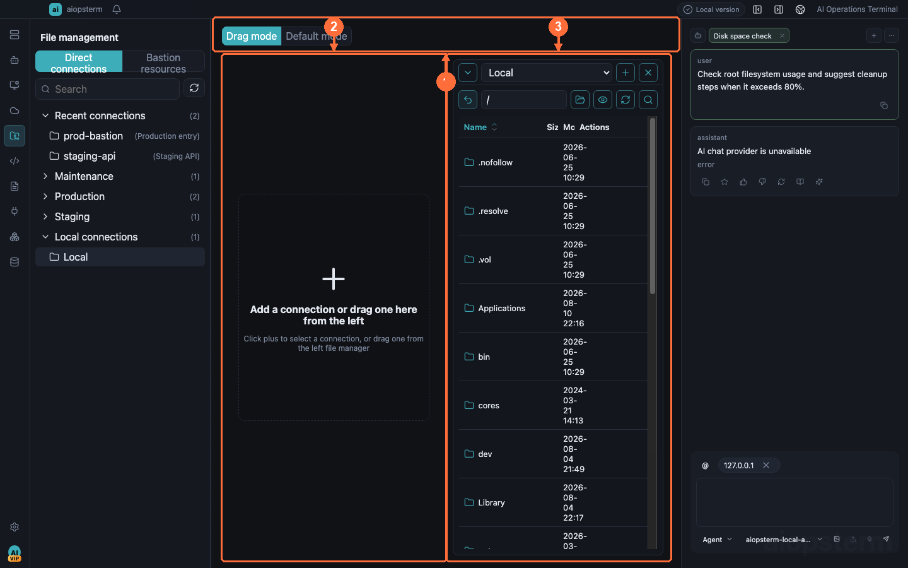

# File Management: Local And Remote SFTP

The Files workspace browses, edits, and transfers content between local directories and SSH hosts while keeping transfer progress visible.

## Where To Open It

Use any of three entry points: click **Files** on the module rail for the full workspace; right-click a terminal pane and choose **File Management** to carry in that SSH host; or click **Add Connection** on an empty Files side and choose an asset or live session.

## Build The Two Sides

1. Click **Add Connection** on either empty side.
2. Choose a local directory, saved asset, or live SSH session.
3. A successful remote connection shows the host and path; a failure keeps the picker visible with the backend error.
4. Combine local/remote, remote/local, or two remote hosts as needed.

## Browse And Edit

- Click a directory name to enter it and use `..` to go up; sort by name, size, or modified time.
- The toolbar toggles hidden files. Symlinks show their target and may be opened as directories.
- Single-click selects; double-clicking a regular file opens the floating editor. Resolve disk conflicts by reloading or explicitly overwriting.
- The row menu provides rename, copy path, move, copy, permissions, and confirmed deletion.

## Transfer

Drag a file or directory onto a real directory row on the other side. Blank-space drops use the current directory. Upload-file, upload-directory, and download actions provide picker-based alternatives. Open the lower-right transfer panel to inspect scanning, verification, transfer, pause, completion and failure states.

- Pause running uploads, downloads or remote copies, then continue. Failed tasks retain their error and can retry unfinished files.
- After restarting the app, unfinished tasks wait for explicit continuation. Completed and failed records remain until removed. Remove old records when the 100-task limit is reached.
- Cancel stops a task permanently. Remove then cleans its unfinished temporary files; remote cleanup may require reconnecting. Completed files and created directories are retained.
- Resuming verifies the source and transferred prefix. Changed sources, partial files or destinations can prevent continuation. Check the changes before removing the task and starting a new transfer. Avoid modifying source trees or destinations during a transfer.
- Large files may spend time verifying before and after copying. The original destination is replaced only after verification; an unsupported replacement operation fails without deleting the original.

Directory transfers include empty directories and symbolic links without traversing link targets. Split trees exceeding 10000 entries or 128 levels. Regular files retain existing destination permissions, or source permissions for new files; ownership and ACLs are not copied. See [recovery implementation and tests](../../../technical/file-transfer-recovery.md).

## Jump Hosts And Relay Limits

Direct SSH and standard TCP-forwarding jump hosts support SFTP. Relay-shell exposes only an interactive terminal stream, so Files rejects it explicitly. Use a forwarding-capable jump host or run `scp`/`rsync` inside the terminal.

## Best Practices And Troubleshooting

- Filter large trees before transferring to avoid logs or dependency caches.
- Record permissions and back up production configuration before editing.
- If connection fails, test the asset first and verify the starting directory and SFTP permission.
- Read the transfer task's operation, source, destination, and backend error before retrying.

Previous: [Third-party MCP Servers](09-third-party-mcp.md) · Next: [Assets](11-assets.md) · [Back to index](../index.md)
